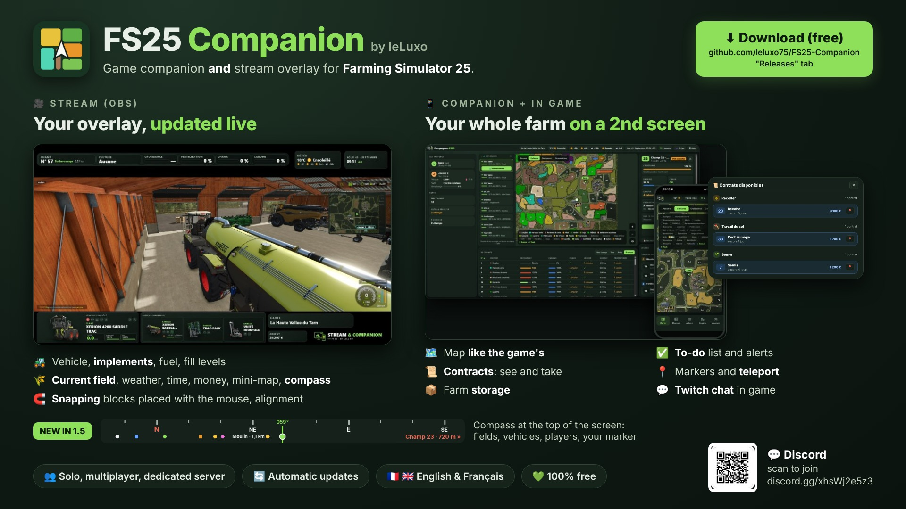

# FS25 Companion — by leLuxo

Compagnon de jeu **et** overlay de stream pour **Farming Simulator 25**. Gratuit, en français et en anglais. Pas besoin d'être streamer : le Compagnon marche aussi tout seul, en solo ou en multi.

*Game companion **and** stream overlay for **Farming Simulator 25**. Free, in English and French. [English below](#english).*

> ⚠️ **Mod non officiel** pour Farming Simulator 25, gratuit, non affilié à GIANTS Software. Farming Simulator est une marque de GIANTS Software. — *Unofficial, free mod for Farming Simulator 25, not affiliated with GIANTS Software.*

- 📱 **Compagnon** (téléphone, tablette ou 2e écran) : carte comme celle du jeu, fiches des champs, engins, bâtiments, animaux et silos, 📦 stocks de la ferme, 📜 contrats (voir, être prévenu, prendre un contrat), liste « À faire », alertes, qui fait quoi, 📍 repères et téléportation, 🛏 dormir.
- 🎮 **Dans le jeu** : blocs d'infos à placer où tu veux (À faire, Qui fait quoi, Météo, Champ actuel, Alertes, 💬 chat Twitch de ton live), 🧭 boussole en haut de l'écran, touche F9.
- 🎥 **Stream (OBS)** : ton véhicule, tes outils, le champ, la météo, l'argent, la boussole… dans une page à ajouter dans OBS, blocs aimantés à placer à la souris.
- 🔄 **Mises à jour en 1 clic** depuis la fenêtre d'accueil de l'application.

## ⬇️ Télécharger

La dernière version est dans **[Releases](../../releases/latest)** : télécharge le fichier d'installation (.exe) et lance-le. C'est le seul fichier nécessaire.

- Windows affiche « Windows a protégé votre ordinateur » : clique sur « Informations complémentaires » puis « Exécuter quand même ».
- Pas besoin de désinstaller l'ancienne version : tes réglages sont gardés.
- L'application installe et met à jour le mod toute seule.
- **Multijoueur** : le serveur (dédié ou hôte) doit avoir la même version du mod. Prends `FS25_Companion.zip` dans la page de la version (Assets) et mets-le dans le dossier mods du serveur. Depuis la 1.5, **retire l'ancien `FS25_StreamDashboard.zip`** du serveur.
- **Crossplay (PlayStation / Xbox)** : l'application et le mod sont pour PC uniquement. Les joueurs console ne peuvent pas rejoindre un serveur où le mod est installé.

## 💬 Aide et communauté

- Discord « FS25 Companion by leLuxo » : https://discord.gg/xhsWj2e5z3
- Soutenir le projet : https://ko-fi.com/leluxo

---

## English

- 📱 **Companion** (phone, tablet or 2nd screen): map like the game's, field / vehicle / building / animal / silo cards, 📦 farm storage, 📜 contracts (see them, get notified, take one), to-do list, alerts, who does what, 📍 markers and teleport, 🛏 sleep.
- 🎮 **In game**: info blocks you place anywhere (to-do, who does what, weather, current field, alerts, 💬 your live's Twitch chat), 🧭 compass at the top of the screen, F9 key.
- 🎥 **Stream (OBS)**: your vehicle, implements, field, weather, money, compass… in a page you add to OBS, snapping blocks placed with the mouse.
- 🔄 **One-click updates** from the app's start window.

**Download**: get the installer (.exe) from **[Releases](../../releases/latest)** and run it. If Windows says "Windows protected your PC", click "More info" then "Run anyway". The app installs and updates the mod by itself.
**Multiplayer**: the server needs the same mod version: put `FS25_Companion.zip` (from the release Assets) in the server's mods folder, and since 1.5 **remove the old `FS25_StreamDashboard.zip`**. PC only: console players can't join a server that runs the mod.
**Help**: Discord https://discord.gg/xhsWj2e5z3 · Support: https://ko-fi.com/leluxo

## Licence

Application et mod gratuits. © 2026 leLuxo — tous droits réservés. Le code source n'est pas public. *Free app and mod. © 2026 leLuxo — all rights reserved. Source code is not public.*

## Privacy policy

The program only contacts the following systems:

- **Update check** (automatic): asks GitHub (api.github.com) for the latest release number of this repository, and downloads the installer from GitHub if you accept an update. No personal data is sent.
- **Automatic vehicle image search** (can be turned off in the settings): sends the vehicle / implement name to an image search engine (DuckDuckGo, Bing, or Google if you enter your own API key), then downloads the chosen picture from the site that hosts it.
- **Twitch chat** (only if you enter your channel name): reads your channel's public chat anonymously from Twitch (irc.chat.twitch.tv). Nothing is sent to the chat.
- **Companion mode**: the app serves a web page on your local network so your phone can connect; nothing goes through an external server.

No account, no analytics, no tracking. All settings stay on your PC.

## Uninstall

Windows Settings > Apps > "FS25 Companion by leLuxo" > Uninstall. The uninstaller also removes the mod and the app data.
