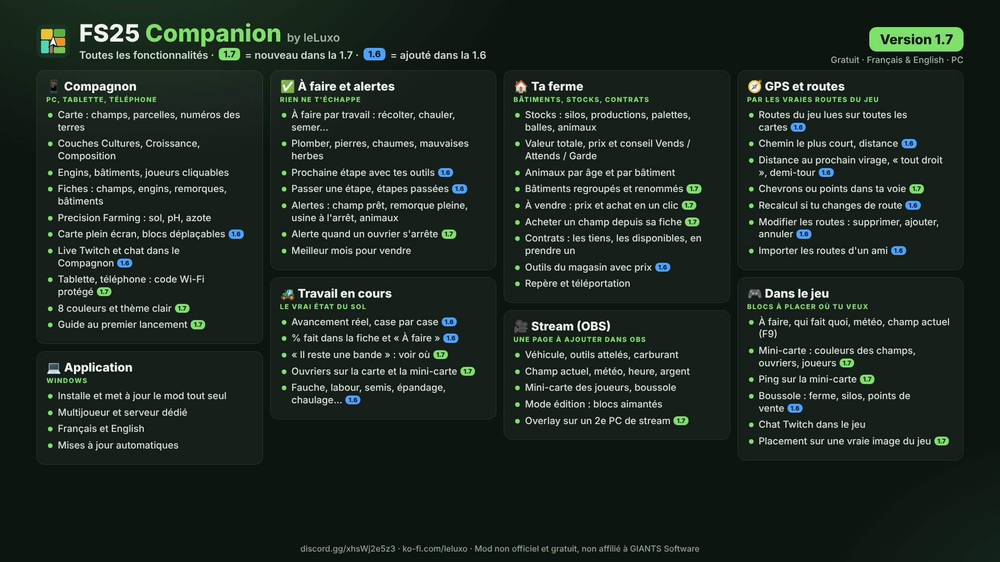
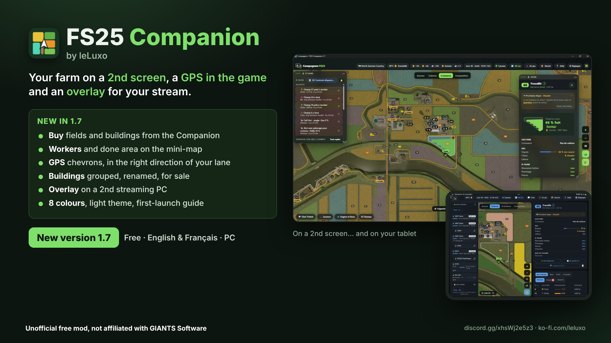
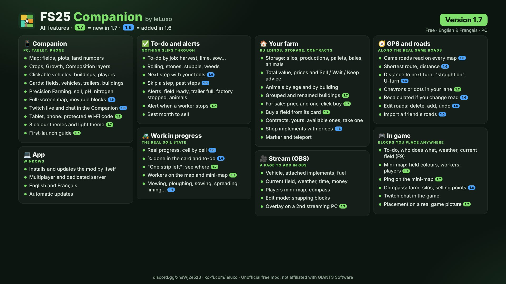

# FS25 Companion — by leLuxo

Compagnon de jeu **et** overlay de stream pour **Farming Simulator 25**. Gratuit, en français et en anglais. Pas besoin d'être streamer : le Compagnon marche aussi tout seul, en solo ou en multi.

*Game companion **and** stream overlay for **Farming Simulator 25**. Free, in English and French. [English below](#english).*

> ⚠️ **Mod non officiel** pour Farming Simulator 25, gratuit, non affilié à GIANTS Software. Farming Simulator est une marque de GIANTS Software. — *Unofficial, free mod for Farming Simulator 25, not affiliated with GIANTS Software.*

- 📱 **Compagnon** (2e écran, tablette ou téléphone) : carte comme celle du jeu, fiches des champs avec la ➜ **prochaine étape** et le travail en cours, 🛒 **achat de champs et de bâtiments**, 🏠 bâtiments **regroupés et renommés**, 📦 stocks avec prix et conseil « Vends / Attends / Garde », 📜 contrats, liste « À faire », alertes (dont l'ouvrier arrêté), qui fait quoi, 📍 repères et téléportation, 💬 live et chat Twitch.
- 🎮 **Dans le jeu** : 🧭 **GPS par les vraies routes** (chevrons ou points dans le bon sens de ta voie), 🗺️ **mini-carte** avec tes ouvriers (zone faite, %), les couleurs des champs, les autres joueurs et le ping, blocs d'infos à placer où tu veux (À faire, Champ actuel, Météo, Alertes, chat Twitch), boussole, touche F9.
- 🎥 **Stream (OBS)** : ton véhicule, tes outils, le champ, la météo, l'argent, la mini-carte… dans une page à ajouter dans OBS, blocs aimantés à placer à la souris, possible sur un 2e PC de stream.
- 🔄 **Mises à jour en 1 clic** depuis la fenêtre d'accueil de l'application.

## 📋 Toutes les fonctionnalités

## ⬇️ Télécharger

La dernière version est dans **[Releases](../../releases/latest)** : télécharge le fichier d'installation (.exe) et lance-le. C'est le seul fichier nécessaire.

- Windows affiche « Windows a protégé votre ordinateur » : clique sur « Informations complémentaires » puis « Exécuter quand même ».
- Pas besoin de désinstaller l'ancienne version : tes réglages sont gardés.
- L'application installe et met à jour le mod toute seule.
- 💡 Lance FS25 Companion **avant** le jeu : si le jeu est déjà ouvert, Windows bloque le fichier du mod et la mise à jour ne peut pas se faire.
- **Multijoueur** : le serveur (dédié ou hôte) doit avoir la même version du mod. Prends `FS25_Companion.zip` dans la page de la version (Assets) et mets-le dans le dossier mods du serveur. Depuis la 1.5, **retire l'ancien `FS25_StreamDashboard.zip`** du serveur.
- **Crossplay (PlayStation / Xbox)** : l'application et le mod sont pour PC uniquement. Les joueurs console ne peuvent pas rejoindre un serveur où le mod est installé.

## 💬 Aide et communauté

- Discord « FS25 Companion by leLuxo » : https://discord.gg/xhsWj2e5z3
- Soutenir le projet : https://ko-fi.com/leluxo

---

## English

- 📱 **Companion** (2nd screen, tablet or phone): map like the game's, field cards with the ➜ **next step** and work in progress, 🛒 **buy fields and buildings**, 🏠 **grouped and renamed** buildings, 📦 storage with prices and "Sell / Wait / Keep" advice, 📜 contracts, to-do list, alerts (including stopped workers), who does what, 📍 markers and teleport, 💬 Twitch live and chat.
- 🎮 **In game**: 🧭 **GPS on the real roads** (chevrons or dots in the right direction of your lane), 🗺️ **mini-map** with your workers (done area, %), field colours, other players and ping, info blocks you place anywhere (to-do, current field, weather, alerts, Twitch chat), compass, F9 key.
- 🎥 **Stream (OBS)**: your vehicle, implements, field, weather, money, mini-map… in a page you add to OBS, snapping blocks you place with the mouse, works on a 2nd streaming PC too.
- 🔄 **One-click updates** from the app's start window.

### 📋 All features

**Download**: get the installer (.exe) from **[Releases](../../releases/latest)** and run it. If Windows says "Windows protected your PC", click "More info" then "Run anyway". The app installs and updates the mod by itself.
**💡 Tip**: start FS25 Companion **before** the game: if the game is already open, Windows locks the mod file and the update can't happen.
**Multiplayer**: the server needs the same mod version: put `FS25_Companion.zip` (from the release Assets) in the server's mods folder, and since 1.5 **remove the old `FS25_StreamDashboard.zip`**. PC only: console players can't join a server that runs the mod.
**Help**: Discord https://discord.gg/xhsWj2e5z3 · Support: https://ko-fi.com/leluxo

## Licence

Application et mod gratuits. © 2026 leLuxo — tous droits réservés. Le code source n'est pas public. *Free app and mod. © 2026 leLuxo — all rights reserved. Source code is not public.*

## Privacy policy

The program only contacts the following systems:

- **Update check** (automatic): asks GitHub (api.github.com) for the latest release number of this repository, and downloads the installer from GitHub if you accept an update. No personal data is sent.
- **Automatic vehicle image search** (can be turned off in the settings): sends the vehicle / implement name to an image search engine (DuckDuckGo, Bing, or Google if you enter your own API key), then downloads the chosen picture from the site that hosts it.
- **Twitch chat** (only if you enter your channel name): reads your channel's public chat anonymously from Twitch (irc.chat.twitch.tv). Nothing is sent to the chat.
- **Companion mode**: the app serves a web page on your local network so your phone can connect; nothing goes through an external server.

No account, no analytics, no tracking. All settings stay on your PC.

## Uninstall

Windows Settings > Apps > "FS25 Companion by leLuxo" > Uninstall. The uninstaller also removes the mod and the app data.
